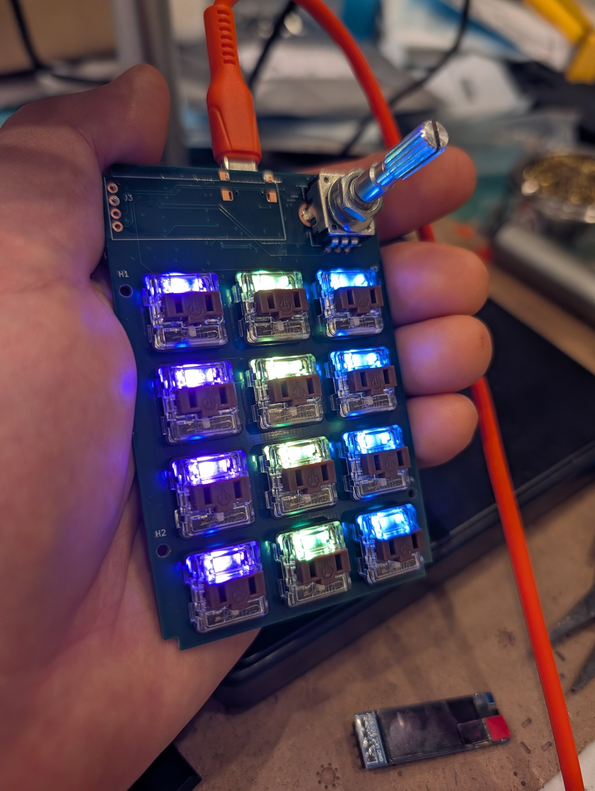

# 2040pad

An RP2040 macropad, and the board you build in my hands-on PCB soldering class.

## Features

- RP2040 microcontroller with USB-C
- 12 Choc key switches
- 12 SK6812MINI-E RGB LEDs
- PEC11R rotary encoder with push switch
- 128x32 SSD1306 OLED
- QMK firmware

## What's here

| Path | Contents |
|---|---|
| `2040pad/` | KiCad schematic and board, plus `gerbs.zip` |
| `firmware/qmk/2040pad/` | QMK keyboard definition, with build and flashing steps |
| `2040pad_assembly.html`, `2040pad_assembly.pdf` | Soldering and assembly guide |
| `docs/` | [Class web page](https://aylo6061.github.io/2040-pcb-assy-class/) |

The case design is coming soon.

## Status

The first board was built on 2026-11-05, and everything works.

## Credits and license

Based on the [Adafruit MacroPad RP2040](https://github.com/adafruit/Adafruit-MacroPad-RP2040-PCB),
designed by Limor Fried/Ladyada for Adafruit Industries. This is not an Adafruit
product, and Adafruit doesn't support or endorse it.

The hardware is released under Creative Commons Attribution-ShareAlike 3.0.
See [license.txt](license.txt).

The firmware is released under GPL-2.0-or-later. It is based on QMK's
`keyboards/adafruit/macropad` definition, Copyright 2022 Jose Pablo Ramirez.
